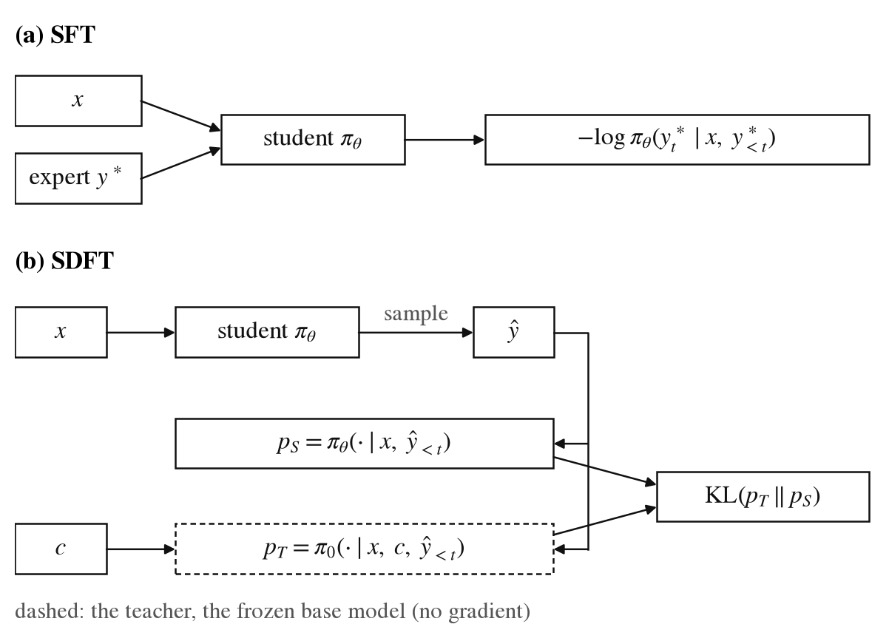
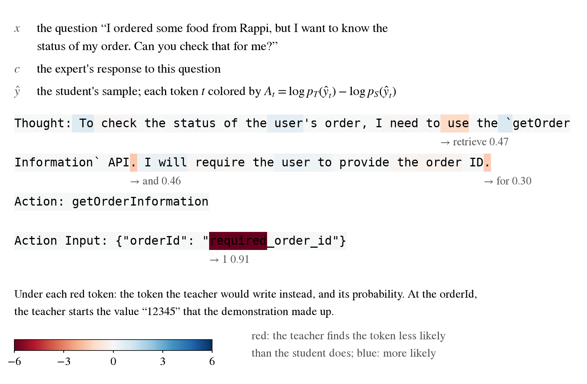

# Homework 3: Self-Distillation

The usual way to teach a model a new skill from demonstrations is supervised fine-tuning (SFT), and it is well
known that SFT makes the model forget some of what it could do before. In the guest lecture we saw an alternative,
[self-distillation (SDFT)](https://arxiv.org/abs/2601.19897), in which the model acts as its own teacher. The teacher
is the same model, but it also gets to read some privileged information, such as the demonstration, that the student
never sees. In this homework you will train a model both ways, find out when self-distillation helps and why, and
then design privileged information of your own.

## Setup

We teach `Qwen2.5-7B-Instruct` (with LoRA) to use tools. In each example of ToolAlpaca the model reads the
documentation of an API and a user's question, and has to write the right tool call; every training example comes
with an expert demonstration. To see how much the model forgets, we also measure two skills it already had:
following formatting instructions (IFEval) and writing Python (HumanEval).

We write $x$ for the prompt and $y$ for a response, with tokens $y_t$. The **student** $\pi_\theta(\cdot \mid x)$ is
the model we train, and $\pi_0$ is the **base model** we start from. The **teacher** is the base model reading both
the prompt and the privileged information $c$, that is $\pi_0(\cdot \mid x, c)$, and it is never trained.



The two methods differ in who writes the response that the student learns from. In SFT it is the expert, and the
student is trained to predict each of the expert's tokens. In SDFT the student writes the response itself, and at
every token it is pulled towards the teacher's distribution:

```math
\mathrm{KL}(p_T \parallel p_S) = \sum_v p_T(v)\,\big[\log p_T(v) - \log p_S(v)\big], \qquad p_S = \pi_\theta(\cdot \mid x,\ y_{\lt t}), \quad p_T = \pi_0(\cdot \mid x,\ c,\ y_{\lt t})
```

In other words, SFT is off-policy (the student learns from text it did not write), while SDFT is on-policy (the
student learns from its own samples, and the teacher tells it, token by token, what it should have written instead).
You may notice that the SDFT paper derives the method from the reverse KL $\mathrm{KL}(p_S \parallel p_T)$, which
Part 4 is about. In practice, though, the authors found the forward KL to work better, and all their reported
results use it, so we do too; `--loss rkl` trains with the reverse KL if you are curious.
The SDFT paper implements the teacher as an exponential moving average (EMA) of the student, updating its weights
after every step as $\theta_T \leftarrow (1 - \alpha)\,\theta_T + \alpha\,\theta$ with $\alpha$ between 0.01 and 0.05,
so that the teacher slowly follows the student. We keep the teacher fixed at the base model instead; this made no
difference in our runs and keeps things simpler.

| run | `--data` | `--loss` |
|---|---|---|
| `sft` | `demo`, the expert's demonstration | `ce`, the cross-entropy $-\log \pi_\theta(y_t \mid x, y_{\lt t})$ |
| `sdft` | `student`, a sample $y \sim \pi_\theta(\cdot \mid x)$ | `fkl`, the forward KL above |

## Files

You will write code in three files. `losses.py` holds the per-token losses (TODO 1 to 3), `train.py` the training
loop (TODO 4 and 5), and `contexts.py` the kinds of privileged information, where you add your own in Part 3 (TODO 6).
`analyze.py` looks at a kind of privileged information before any training.

The package `hw3/` holds the supporting code, which you do not need to change:

| file | what it does |
|---|---|
| `model.py` | Loads the model with a LoRA adapter, samples responses, and computes the next-token logits of a given response. It also lets the same network act as the teacher, by temporarily swapping in the base model's weights. `train.py` is built on these helpers, so this file is worth reading before you start. |
| `data.py` | Downloads ToolAlpaca and splits it into training examples, held-out examples (used by `analyze.py` and for testing) and the paper's test set. |
| `evaluate.py` | Scores the new task: a response is correct if it calls the right tools with exactly the right arguments. It also measures `kl_to_base`. |
| `prior.py` | Runs IFEval and HumanEval with lm-evaluation-harness, to measure forgetting. |
| `report.py` | Collects all runs into `summary.md` and `results.png`, with confidence intervals for the differences. |
| `check.py` | Tests your losses (TODO 1 to 3) against PyTorch's own KL. |

## Compute

Do Part 0 on your laptop. For the rest you need a GPU with at least 48 GB of memory, which you can rent on
[Prime Intellect](https://app.primeintellect.ai) with the $200 of credits each of you has. In your personal account,
open **Billing** and enter the class code from the email we sent out, and add your public SSH key under **Profile**.
Then install the command-line tool and create a pod:

```bash
uv tool install prime && prime login
prime config set-ssh-key-path <private key>   # e.g. ~/.ssh/id_ed25519 (not the .pub file)
prime pods create                             # asks a few questions; see below
prime pods ssh <pod-id>                       # once it is running (prime pods list)
prime pods terminate <pod-id>                 # when you are done; this deletes everything on the pod
```

When `prime pods create` asks, pick a **single** GPU (a configuration starting with `1x`; an `8x` pod costs eight
times as much) with at least 48 GB, and a provider that is not marked "spot", which can be taken away at any time.
About 150 GB of disk is enough. These are the GPUs we tried; the whole homework costs about the same on each:

| GPU | price | one SDFT run | the whole homework |
|---|---|---|---|
| H100_80GB | $4.89 / h | 27 min | about 2 h, $10 |
| A100_80GB | $2.41 / h | 55 min | about 3.5 h, $9 |
| RTX6000Ada_48GB | $1.64 / h | 70 min | about 4 h, $7 |

What is available changes from minute to minute; if nothing suitable is listed, try again later. The
[Prime Intellect docs](https://docs.primeintellect.ai) cover the rest. A pod charges until you terminate it, so copy
your results off it first, and run long jobs inside `tmux`.

## Install

On your laptop, and again on the pod, clone the repository and install it with [uv](https://docs.astral.sh/uv/):

```bash
git clone https://github.com/MIT-MI/ai4ai-homework-3.git hw3 && cd hw3
curl -LsSf https://astral.sh/uv/install.sh | sh && source $HOME/.local/bin/env   # if uv is missing
uv venv --python 3.12 && source .venv/bin/activate
uv pip install -r requirements.txt --torch-backend=cu126   # on your laptop, leave out --torch-backend
python -m hw3.data                                          # downloads the data
```

`--torch-backend=cu126` installs a build of PyTorch that also works with the older GPU drivers of some providers;
without it you may see "The NVIDIA driver on your system is too old".

## Part 0. Implement

| TODO | where | what |
|---|---|---|
| 1 | `losses.forward_kl` | the forward KL $\mathrm{KL}(p_T \parallel p_S)$ at each token |
| 2 | `losses.reverse_kl` | the reverse KL $\mathrm{KL}(p_S \parallel p_T)$ at each token |
| 3 | `losses.advantage` | the advantage $A_t = \log p_T(y_t) - \log p_S(y_t)$ at each token |
| 4 | `train.sample_response` | let the student sample its own response |
| 5 | `train.compute_loss` | the loss: cross-entropy for SFT, the KL to the teacher for SDFT |

Test your losses, then run the whole loop with a tiny model on a CPU (about two minutes):

```bash
python -m hw3.check
python train.py --run runs/debug --data student --loss fkl --model HuggingFaceTB/SmolLM2-135M-Instruct \
    --n-train 16 --n-eval 8 --batch-size 4 --max-new-tokens 32
```

## Part 1. What should the teacher read?

`contexts.py` offers four kinds of privileged information: `demo`, the expert's response (this is what SDFT uses);
`answer`, only the correct tool calls; `other`, the expert's response to a different question about the same API;
and `none`. Before training anything, `python analyze.py` takes 100 held-out examples and, for each kind, measures
how often the teacher gets the answer right and how far it is from the student. It also shows where in the student's
own responses the teacher disagrees, by coloring each token with $A_t$:



The results go to `runs/analyze/` and take about ten minutes. `summary.md` has the table. `heatmap_<context>.html`
shows, for eight examples, the student's response colored by $A_t$; below it, the tokens where the teacher disagrees
most, with what the teacher would have written instead, and the teacher's own response to the same question (hover
over a token to see both probabilities). `teacher_<context>.jsonl` has the teacher's responses to all 100 questions.

1. Where is $|A_t|$ large in the heatmaps of `demo` and `answer`, and what would the teacher write there instead? The
   `demo` teacher has the correct response right in front of it, yet it is often wrong. Compare its responses with
   the demonstrations: why does it not simply follow them, and what does this tell you about what self-distillation
   can teach?

## Part 2. SFT against SDFT

Measure the base model, then train with each method and measure again:

```bash
python -m hw3.evaluate runs/base && python -m hw3.prior runs/base
python train.py --run runs/sft  --data demo    --loss ce  && python -m hw3.prior runs/sft
python train.py --run runs/sdft --data student --loss fkl && python -m hw3.prior runs/sdft
python -m hw3.report --versus sft
```

Each run makes one pass over 2,000 training examples. For every run you get the new-task accuracy and `kl_to_base`,
how far the model has moved from $\pi_0$ (`metrics.json`), every test response (`eval.jsonl`), and the IFEval and
HumanEval scores (`prior.json`). The report puts them together in `runs/summary.md` and `runs/results.png`. Keep the
noise in mind: new-task accuracy has a standard error of about 2.5 points and the prior-task scores move by 1 to 2
points, so `summary.md` gives every difference with a 95% interval.

1. How do `sft` and `sdft` compare on the new task, and on the prior tasks? Which differences are real? Look at test
   examples where the two runs disagree, and explain what you see using Part 1.
2. [RL's Razor](https://arxiv.org/abs/2509.04259) argues that forgetting is predicted by how far the model moves
   from $\pi_0$ on the new task. Do your runs agree? Why would on-policy training move the model less?

## Part 3. Your own privileged information

Now design what the teacher reads. Write `mine` in `contexts.py` (TODO 6). It receives the example and the response the
student has just written, so $c$ can be a hint, a rule, part of the answer, or feedback on the student's attempt, the
way an environment would give it (as in [SDPO](https://arxiv.org/abs/2601.20802)). Have a reason for your choice;
Part 1 may give you one. Analyze it first, write down the accuracy and forgetting you expect, and only then train:

```bash
python analyze.py --contexts demo mine --out runs/analyze_mine
python train.py --run runs/sdft_mine --data student --loss fkl --context mine && python -m hw3.prior runs/sdft_mine
python -m hw3.report --versus sdft
```

1. Was your prediction right? Did the teacher's accuracy in the analysis predict how well the student did after
   training?
2. Does your $c$ tell the teacher something the student could never work out from $x$, for example a value that is
   not in the question? Look at what the student learned to write at those tokens. What, then, makes privileged
   information good for self-distillation?

A wrong prediction gets full marks if you explain it well.

## Part 4. Theory

Let $\pi_T(y \mid x, c) = \pi_0(y \mid x, c)$ be the teacher and $\pi^\ast(y \mid x)$ the expert, both as distributions
over whole responses $y$. Use natural logarithms.

1. **Reverse KL is reinforcement learning.**
   1. Show that the SFT loss $`L_{\text{SFT}}(\theta) = -\mathbb{E}_{y \sim \pi^\ast}[\log \pi_\theta(y \mid x)]`$ equals
      $\mathrm{KL}(\pi^\ast \parallel \pi_\theta)$ up to a constant, and write $\mathrm{KL}(\pi_\theta \parallel \pi_T)$
      as an expectation too. In each, from which distribution is $y$ drawn, that is, who has to write the responses?
   2. Show that

      $`\displaystyle \nabla_\theta \mathrm{KL}(\pi_\theta \parallel \pi_T) = -\mathbb{E}_{y \sim \pi_\theta}\left[ r(y) \nabla_\theta \log \pi_\theta(y \mid x) \right], \qquad r(y) = \log \pi_T(y \mid x, c) - \log \pi_\theta(y \mid x)`$

      Hint: write the KL as a sum over responses, $`\sum_y \pi_\theta(y \mid x)\,(\log \pi_\theta(y \mid x) - \log \pi_T(y \mid x, c))`$,
      differentiate it with the product rule, and use $\nabla_\theta \pi_\theta = \pi_\theta \nabla_\theta \log \pi_\theta$
      and $`\mathbb{E}_{y \sim \pi_\theta}[\nabla_\theta \log \pi_\theta(y \mid x)] = 0`$. This is the policy gradient
      with reward $r(y)$.
   3. Write $\nabla_\theta L_{\text{SFT}}$ in the same form: what are the distribution and the reward? Suppose the
      student writes a response that the teacher finds much less likely than the student does. Which of the two
      gradients lowers its probability?

2. **Two right answers.** The student is writing a tool call and has reached `{"query": "flowers", `. The next
   argument can be `"latitude"` or `"radius"`: both are correct, since the order of the arguments does not matter.
   `"location"` is wrong, since the tool has no such argument. Over these three choices, in this order, the teacher
   has $p_T = (0.495,\ 0.495,\ 0.01)$.
   1. Compute the forward KL $\mathrm{KL}(p_T \parallel q)$ and the reverse KL $\mathrm{KL}(q \parallel p_T)$ for two
      students: $q_1 = (0.98,\ 0.01,\ 0.01)$, which almost always writes `"latitude"`, and
      $q_2 = (0.3,\ 0.3,\ 0.4)$, which often writes the wrong `"location"`.
   2. Which student does each divergence prefer? What kind of mistake does each divergence punish most?
   3. Suppose the base model, like $q_1$, almost always writes `"latitude"`. Under which divergence is it already
      close to the best, so that training changes it less? By RL's Razor, which would then forget less?

3. **The student cannot see $c$.** Many questions ask about an order without giving its ID, and their demonstrations
   made up an ID, each a different one: say half of them start with 1 and half with 9. To the student, which reads
   only the question, these questions look the same. The teacher also reads the demonstration, so it is in effect two
   different teachers. At the first character of the ID, over the tokens (`1`, `9`, `<`), where `<` starts a
   placeholder such as `<order_id>`, the teacher has $p_{T,1} = (0.80,\ 0.01,\ 0.19)$ when the demonstration's ID starts
   with 1, and $p_{T,9} = (0.01,\ 0.80,\ 0.19)$ when it starts with 9. The student must give one distribution $q$ for
   both.
   1. Show that the $q$ that minimizes the average forward KL, $`\tfrac12 \mathrm{KL}(p_{T,1} \parallel q) + \tfrac12 \mathrm{KL}(p_{T,9} \parallel q)`$,
      is the average of the two teachers, and that the $q$ that minimizes the average reverse KL,
      $`\tfrac12 \mathrm{KL}(q \parallel p_{T,1}) + \tfrac12 \mathrm{KL}(q \parallel p_{T,9})`$, is proportional to
      their geometric mean, $`\sqrt{p_{T,1}(v)\, p_{T,9}(v)}`$ for each token $v$.
   2. Compute both students. Which one guesses an ID, and which one writes a placeholder?
   3. Compare with what your student learned in Part 3, question 2.

## Submit

Please hand in `report.md` (start from `report_template.md`), your `losses.py`, `train.py` and `contexts.py`, and your
results without the adapters: `zip -r runs.zip runs -x '*/adapter/*' -x '*/lm_eval/*'`.

## References

- [Self-Distillation Enables Continual Learning](https://arxiv.org/abs/2601.19897), the SDFT paper, and its
  [code](https://github.com/idanshen/Self-Distillation), where our data comes from.
- [RL's Razor](https://arxiv.org/abs/2509.04259), on why on-policy learning forgets less.
- [On-Policy Distillation](https://thinkingmachines.ai/blog/on-policy-distillation/) by Thinking Machines, on the
  reverse KL as a per-token reward.
- [OPSD](https://arxiv.org/abs/2601.18734), [SDPO](https://arxiv.org/abs/2601.20802) and
  [Privileged Information Distillation](https://arxiv.org/abs/2602.04942), which give the teacher other kinds of
  privileged information.
- [Rethinking OPSD for Thinking Models](https://arxiv.org/abs/2607.05184), a case where self-distillation hurts.
